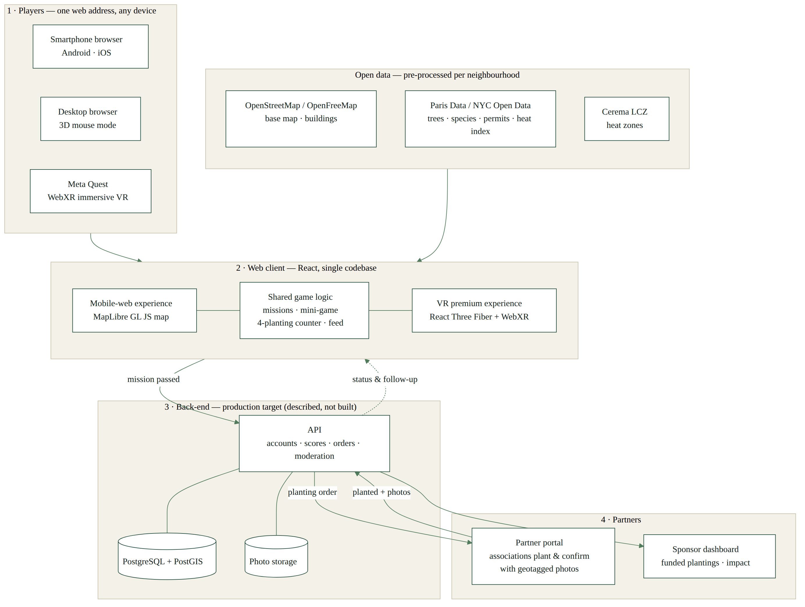

# 3. Product & Technology

EcoScape VR turns a short plant-care game into a real, geolocated planting carried out by local partners. This section covers the gameplay loop (3.1), the architecture and data pipeline (3.2), and device accessibility (3.3). The launch city and the planting mix are configuration parameters, so the design works for both Paris and New York. Appendix A gives the extended version, including the full device matrix and data-flow detail.

## 3.1 Core Mechanics & Gameplay Loop

**The loop.** The player (1) **explores** a map of their neighbourhood showing hot spots, plantable spots and existing plantings; (2) **learns** through a mission at a plantable spot: choose the right plant, water it at the right rhythm, manage the soil; (3) **succeeds** by passing the score threshold; (4) **unlocks** a real, named and geolocated planting carried out by a partner association or sponsor; (5) **follows** it through partner photo updates; and (6) **shares** it in the neighbourhood feed or as a story-format image. Hot spots come from the Cerema Local Climate Zones map (Cerema, 2026). Existing trees and plantings come from City of Paris open data (Ville de Paris, 2026a; 2026b).

Location-based play has a track record. In a study of 32,000 wearable-device users, highly engaged Pokémon Go players walked 1,473 more steps a day on average over 30 days, more than 25% above their previous level (Althoff, White and Horvitz, 2016). EcoScape keeps the "missions on a real map" structure, but the reward is a real planting.

**Rules grounded in real data.** Mission rules come from the City of Paris tree-species guide. For 200 species it lists the suitable sun exposure, the soil-water conditions each tolerates, and the types of site where it can be planted (Ville de Paris, 2026c). For flowers and edible plants, the rules follow the charter of the City's *permis de végétaliser*: local and bee-friendly plants, no pesticides, no plastic, and year-round maintenance (Ville de Paris, 2025).

**The four-planting limit.** Each player can unlock at most four real plantings. This creates scarcity, keeps the partners' maintenance commitment finite, and makes sponsor costs predictable. After four, players continue with badges, neighbourhood challenges and "adopt a plant" care missions on existing plantings.

**Social and educational layer.** Gamification, "the use of game design elements in non-game contexts" (Deterding *et al.*, 2011), tends to have positive effects that depend strongly on context and users (Hamari, Koivisto and Sarsa, 2014). EcoScape therefore keeps only mechanics that support learning and real-world care:

| Mechanic | Purpose |
|---|---|
| Neighbourhood challenges | Turn individual play into collective local action |
| Skill badges (*Shade Expert*, *Bee Buddy*…) | Reward what was learned in the mini-game |
| Planting feed | Show that plantings are real and maintained over time |
| Adopt a plant | Extend engagement beyond the four-planting limit |
| Story export | Organic acquisition through social sharing |

**City context.** In Paris, the *permis de végétaliser* already lets groups of residents, associations, schools or businesses plant at tree bases, in de-paved ground or in planters on public space (Ville de Paris, 2025). There are 1,732 permits in open data (Ville de Paris, 2026d). EcoScape can act as a legal "guerrilla gardening" front door to this scheme. In New York, Local Law 148 of 2023 requires an Urban Forest Plan aiming at 30% canopy cover (New York City Council, 2023). The April 2026 plan sets 2040 as the horizon (NYC Mayor's Office of Climate and Environmental Justice, 2026), ten years later than the PlaNYC goal of 2030. Canopy stood at 23.4% in 2021 (Office of the New York City Comptroller, 2026). For comparison, Paris reports a canopy index of 17.57% within the city walls in 2025 (Ville de Paris, 2026e).

## 3.2 Technical Architecture & Data Pipeline

{width=100%}

**One client, two experiences.** A single React web application serves both the mobile-web experience, a map built with MapLibre GL JS (MapLibre, n.d.), and the VR premium experience, a 3D scene built with React Three Fiber and its WebXR extension (Poimandres, n.d.a; n.d.b). Both share the same game logic and configuration (city, plant catalogue, partners). Immersive mode relies on the W3C WebXR Device API (W3C, 2026). The base map and 3D buildings come from OpenStreetMap data via OpenFreeMap, at no API cost, with the required attribution (OpenFreeMap, n.d.; OpenStreetMap Foundation, n.d.).

**Back-end (production target; described, not built).** The production system would include:

- an API for accounts, scores, the four-planting counter, the feed and moderation;
- a PostgreSQL database with PostGIS for geospatial queries (PostGIS, n.d.);
- photo storage;
- a **partner portal** and a **sponsor dashboard**.

The prototype replaces all of this with realistic mock data and local browser storage.

**From mission to planting.** (1) A passed mission is checked against the player's counter. (2) The API creates a planting order: location, plant, name, partner and sponsor. (3) The partner plants and confirms with a geotagged photo. (4) The player's page, the feed and the sponsor dashboard update. (5) Follow-up photos track growth over time.

**Privacy by design.** Under the GDPR's data-minimisation and data-protection-by-design principles (European Parliament and Council of the European Union, 2016, arts. 5 and 25):

- geolocation is optional and requested only when needed, in a secure (HTTPS) context with user permission (MDN, n.d.a);
- players' live positions are never stored;
- only planting locations are public;
- photos show plants, not people.

**Why web first, Unity later.** Unity's Web platform now supports iOS Safari 15+ and Chrome on Android (Unity Technologies, 2026), so Unity remains a valid production target for a richer Meta Quest experience. For the MVP, a native web stack keeps one codebase for map, mobile and VR, speeds up iteration, and opens instantly from a QR code. That makes it the most direct test of our "zero friction" promise.

## 3.3 Hardware Accessibility & Fallback

EcoScape follows **progressive enhancement**: essential features work for everyone first, and richer layers are added where the device supports them (MDN, n.d.b). Support is detected at runtime rather than guessed from the device, as Meta recommends for WebXR (Meta, n.d.).

| Feature | Android phone | iPhone | Desktop | Meta Quest |
|---|---|---|---|---|
| Map, missions, mini-game, feed | ✅ | ✅ | ✅ | ✅ |
| 3D neighbourhood (touch/mouse) | ✅ | ✅ | ✅ | ✅ |
| Immersive VR (WebXR) | ❌ | ❌ | ➖ | ✅ |
| Camera AR (WebXR) | ✅ ARCore | ❌ | ❌ | ✅ passthrough |
| Fallback | — | 3D touch + simulated geofencing | 3D mouse mode | — |

*Source: WebXR support by browser from Abratabia (2026). Safari on iOS does not support the WebXR Device API; Chrome on Android supports immersive AR but not immersive VR on phones; Quest Browser supports both.*

**Implications.** Every player can complete the full loop in a phone browser without installing anything. iPhone users get the same game, with 3D in touch mode. The Meta Quest is the premium layer, reached at the same web address. AR is offered only where supported. For the live pitch, a demo mode removes the dependence on GPS. If no headset is available, VR is shown in the browser's 3D mode and on video.

## References

Abratabia (2026) *WebXR browser and headset support*. Available at: https://abratabia.com/webxr-games/webxr-device-support.php (Accessed: 1 November 2026).

Althoff, T., White, R.W. and Horvitz, E. (2016) 'Influence of Pokémon Go on physical activity: study and implications', *Journal of Medical Internet Research*, 18(12), e315. Available at: https://doi.org/10.2196/jmir.6759.

Cerema (2026) *Cartographie des zones climatiques locales (LCZ) des 93 territoires de plus de 50 000 habitants en France* [dataset]. data.gouv.fr. Available at: https://www.data.gouv.fr/datasets/cartographie-des-zones-climatiques-locales-lcz-des-93-territoires-de-plus-de-50-000-habitants-en-france (Accessed: 1 November 2026).

Deterding, S., Dixon, D., Khaled, R. and Nacke, L. (2011) 'From game design elements to gamefulness: defining "gamification"', in *Proceedings of the 15th International Academic MindTrek Conference: Envisioning Future Media Environments*. Tampere: ACM, pp. 9–15. Available at: https://doi.org/10.1145/2181037.2181040.

European Parliament and Council of the European Union (2016) *Regulation (EU) 2016/679 (General Data Protection Regulation)*. Available at: https://eur-lex.europa.eu/eli/reg/2016/679/oj (Accessed: 1 November 2026).

Hamari, J., Koivisto, J. and Sarsa, H. (2014) 'Does gamification work? A literature review of empirical studies on gamification', in *2014 47th Hawaii International Conference on System Sciences*. IEEE, pp. 3025–3034. Available at: https://doi.org/10.1109/HICSS.2014.377.

MapLibre (n.d.) *MapLibre GL JS documentation*. Available at: https://maplibre.org/maplibre-gl-js/docs/ (Accessed: 1 November 2026).

MDN (n.d.a) *Geolocation API*. Mozilla Developer Network. Available at: https://developer.mozilla.org/en-US/docs/Web/API/Geolocation_API (Accessed: 1 November 2026).

MDN (n.d.b) *Progressive enhancement*. Mozilla Developer Network. Available at: https://developer.mozilla.org/en-US/docs/Glossary/Progressive_Enhancement (Accessed: 1 November 2026).

Meta (n.d.) *WebXR overview*. Meta Horizon developer documentation. Available at: https://developers.meta.com/horizon/documentation/web/webxr-overview/ (Accessed: 1 November 2026).

New York City Council (2023) *Local Law 148 of 2023 (Int. No. 1065-A) — Urban forest plan*. Available at: https://intro.nyc/local-laws/2023-148 (Accessed: 1 November 2026).

NYC Mayor's Office of Climate and Environmental Justice (2026) *NYC Urban Forest Plan*. New York: City of New York, April. Available at: https://www.nyc.gov/assets/climate/downloads/pdfs/NYC-Urban-Forest-Plan-2026.pdf (Accessed: 1 November 2026). [À VÉRIFIER: page number]

Office of the New York City Comptroller (2026) *New York City's living infrastructure: funding and managing NYC's urban forest and tree canopy*. Primary author: K. Imas. 23 April. Available at: https://comptroller.nyc.gov/reports/new-york-citys-living-infrastructure-funding-and-managing-nycs-urban-forest-and-tree-canopy/ (Accessed: 1 November 2026).

OpenFreeMap (n.d.) *OpenFreeMap*. Available at: https://openfreemap.org/ (Accessed: 1 November 2026).

OpenStreetMap Foundation (n.d.) *Copyright and licence*. Available at: https://www.openstreetmap.org/copyright (Accessed: 1 November 2026).

Poimandres (n.d.a) *react-three-fiber* [software]. GitHub. Available at: https://github.com/pmndrs/react-three-fiber (Accessed: 1 November 2026).

Poimandres (n.d.b) *@react-three/xr* [software]. GitHub. Available at: https://github.com/pmndrs/xr (Accessed: 1 November 2026).

PostGIS (n.d.) *PostGIS — spatial and geographic objects for PostgreSQL*. Available at: https://postgis.net/ (Accessed: 1 November 2026).

Unity Technologies (2026) *Web browser compatibility*. Unity 6.6 User Manual. Available at: https://docs.unity.com/en-us/engine/current/manual/platform-specific/webgl/intro/browsercompatibility (Accessed: 1 November 2026).

Ville de Paris (2025) *Le permis de végétaliser*. Last updated 19 November 2025. Available at: https://www.paris.fr/pages/un-permis-pour-vegetaliser-paris-2689 (Accessed: 1 November 2026).

Ville de Paris (2026a) *Arbres* [dataset]. Paris Data. Available at: https://opendata.paris.fr/explore/dataset/les-arbres/ (Accessed: 1 November 2026).

Ville de Paris (2026b) *Arbres plantés* [dataset]. Paris Data. Available at: https://opendata.paris.fr/explore/dataset/arbres-plantes-par-projet/ (Accessed: 1 November 2026).

Ville de Paris (2026c) *Fiches essences du guide des essences de Paris* [dataset]. Paris Data. Available at: https://opendata.paris.fr/explore/dataset/fiches-essences-du-guide-des-essences-de-paris/ (Accessed: 1 November 2026).

Ville de Paris (2026d) *Permis de végétaliser* [dataset]. Paris Data. Available at: https://opendata.paris.fr/explore/dataset/permis-de-vegetaliser/ (Accessed: 1 November 2026).

Ville de Paris (2026e) *Indice de canopée* [dataset]. Paris Data. Available at: https://opendata.paris.fr/explore/dataset/indice-de-canopee/ (Accessed: 1 November 2026).

W3C (2026) *WebXR Device API*. W3C Candidate Recommendation Draft, 29 October. Available at: https://www.w3.org/TR/webxr/ (Accessed: 1 November 2026).
