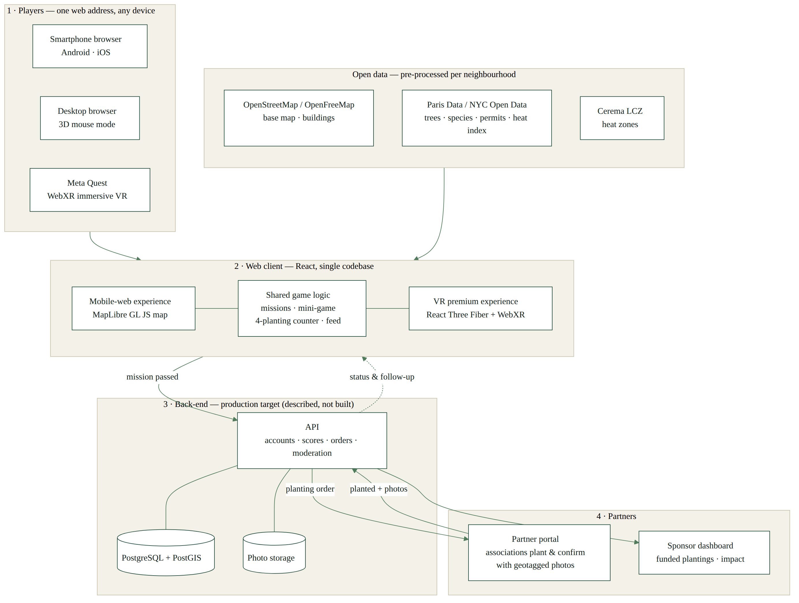

# Appendix A — Product & Technology (extended version of Section 3)

EcoScape VR turns a short, game-based lesson in plant care into a real, geolocated planting carried out by local partners. This section sets out how the game works (3.1), how the system is built and how data flows from the player to the planting partner (3.2), and how the experience stays accessible on any device, from a basic smartphone to a VR headset (3.3).

The launch city and the planting mix are still open decisions for the team. The product is therefore designed so that both are configuration parameters. Examples below use Paris, with New York shown where its data or regulation differs.

## 3.1 Core Mechanics & Gameplay Loop

### 3.1.1 The loop

The core loop has six steps. Each step maps to one screen of the prototype.

1. **Explore.** The player opens a map of their neighbourhood. It shows hot spots, plantable spots, and plantings that already exist. Hot spots come from the Cerema Local Climate Zones map, which covers Paris among 93 French urban areas (Cerema, 2026). Existing trees and recent plantings come from the City of Paris open data (Ville de Paris, 2026a; 2026b).
2. **Learn.** At a plantable spot, the player starts a mission: pick the right plant for the location, water it at the right rhythm, and look after the soil.
3. **Succeed.** A score above the pass mark validates the mission. A failed attempt explains what went wrong and lets the player try again.
4. **Unlock.** A successful mission unlocks one real planting. It is named by the player, geolocated, and assigned to a partner (an association or a sponsor) who plants it.
5. **Follow.** The player follows their planting through partner photo updates and an estimated impact indicator.
6. **Share.** The planting, badges, and challenge results appear in the neighbourhood feed and can be exported as a story-format image.

Linking a game to physical places has precedent. In a study of 32,000 wearable-device users, particularly engaged Pokémon Go players increased their activity by 1,473 steps a day on average over 30 days, more than 25% above their previous level. The authors also call for research on long-term effects (Althoff, White and Horvitz, 2016). EcoScape uses the same "missions on a real map" structure, but the reward is a real-world planting rather than a virtual item.

### 3.1.2 Plant-care rules grounded in real data

The mini-game rules are not invented for the game. They come from the City of Paris tree-species guide, published as open data with 200 species sheets. For each species, the guide lists the possible sun exposure (sun, partial shade, shade), the soil-water conditions it tolerates (from very dry to saturated), and the types of site where it can be planted, such as street alignments, squares, school yards or riverbanks (Ville de Paris, 2026c). A mission therefore asks a concrete question: *this corner is shaded and the soil is dry, so which species will survive here?* The answer is checked against the guide.

For flowers and edible plantings, the rules follow the charter of the City's *permis de végétaliser*. Holders commit to local and melliferous (bee-friendly) plants, no pesticides, no plastic, and year-round watering and maintenance (Ville de Paris, 2025). Watering rhythms and soil management in the mini-game are deliberately simplified for teaching purposes. They are not horticultural advice.

### 3.1.3 The four-planting limit

Each player can unlock **at most four real plantings**. The limit serves three purposes:

- **Scarcity.** Each unlock feels earned, which supports retention and sharing.
- **Quality of follow-up.** Partners commit to maintaining a finite number of plantings. This matters because the City's own scheme makes the holder responsible for planting, watering, maintenance and cleaning (Ville de Paris, 2025).
- **Budget predictability.** Sponsors can forecast their maximum cost per active player.

After four plantings, players keep playing for badges, challenges and "adopt a plant" care missions on existing plantings. These have no new planting cost.

### 3.1.4 Social and educational mechanics

Gamification is defined as "the use of game design elements in non-game contexts" (Deterding *et al.*, 2011). A review of empirical studies found that its effects are generally positive but depend strongly on the context and on the users involved (Hamari, Koivisto and Sarsa, 2014). EcoScape therefore limits game elements to those that support learning and real-world care:

| Mechanic | What it does | Educational purpose |
|---|---|---|
| **Neighbourhood challenges** | Collective goals, e.g. "10 shaded spots planted in Belleville this month" | Turns individual play into local collective action |
| **Badges** | E.g. *Shade Expert*, *Bee Buddy*, *Soil Saver* | Reward specific skills learned in the mini-game |
| **Planting feed** | A timeline of new and growing plantings nearby | Shows that plantings are real and maintained over time |
| **Adopt a plant** | Care reminders for an existing planting | Extends the experience beyond the four-planting limit |
| **Story export** | Shareable vertical image (planting name, location, partner) | Organic acquisition; the social-network side requested for the concept |

**The guerrilla-gardening angle, made legal.** In Paris, the *permis de végétaliser* already authorises groups of residents, associations, schools or businesses to plant at the base of trees, in ground opened after removing asphalt, or in planters on public space (Ville de Paris, 2025). The City's open data lists 1,732 such permits (Ville de Paris, 2026d). EcoScape can present itself as the digital front door to this scheme: guerrilla-gardening energy, channelled through a legal and maintained route.

**New York equivalent.** Local Law 148 of 2023 requires an Urban Forest Plan with the goal of expanding canopy cover equitably to 30% of the city's land (New York City Council, 2023). The first plan, published in April 2026, keeps the 30% target with a 2040 horizon (NYC Mayor's Office of Climate and Environmental Justice, 2026). The City Comptroller notes that this moves the canopy goal from 2030, as set in PlaNYC (2023), back by ten years to 2040, and reports canopy cover of 23.4% as of 2021 (Office of the New York City Comptroller, 2026). For comparison, the City of Paris reports a canopy index of 17.57% within the city walls and 25.24% including its two woods in 2025 (Ville de Paris, 2026e).

## 3.2 Technical Architecture & Data Pipeline

### 3.2.1 Overview

The architecture separates a single web client, which serves both mobile and VR, from a light back-end and the partner side. Figure 3.1 summarises it.

{width=100%}

### 3.2.2 Components

**Client (one codebase, two experiences).** A web application built with React renders:

- the **mobile-web** experience: 2D/2.5D map with MapLibre GL JS, an open-source library for interactive vector maps in the browser (MapLibre, n.d.);
- the **VR premium** experience: a 3D scene built with React Three Fiber, a React renderer for three.js (Poimandres, n.d.a), and its XR extension for WebXR sessions (Poimandres, n.d.b).

Both share the same game logic, data and configuration (city, plant catalogue, partners). Immersive sessions rely on the WebXR Device API, a W3C Candidate Recommendation Draft (W3C, 2026).

**Map and 3D data.** Base map tiles come from OpenFreeMap, a free map-tile service built on OpenStreetMap data (OpenFreeMap, n.d.). OpenStreetMap data is licensed under the Open Database License and requires attribution (OpenStreetMap Foundation, n.d.). Building footprints from the same data are extruded into simple 3D volumes for the VR neighbourhood.

**Open data layers.** These are pre-processed into light per-neighbourhood files:

- *Paris:* street trees (Ville de Paris, 2026a), recent plantings (Ville de Paris, 2026b), species guide (Ville de Paris, 2026c), vegetation permits (Ville de Paris, 2026d), cool islands (Ville de Paris, 2026f), and Local Climate Zones for heat (Cerema, 2026).
- *New York:* Forestry Tree Points (NYC Parks, 2026) and the Heat Vulnerability Index (NYC Department of Health and Mental Hygiene, 2024).

**Back-end (described here; not built in the prototype).** The production target is:

- an API for accounts, missions, scores, the four-planting counter, the social feed and moderation;
- a relational database with geospatial support, such as PostgreSQL with PostGIS, which adds storage and queries for location data (PostGIS, n.d.);
- an object store for partner photos;
- a **partner portal** where associations receive validated planting orders, confirm the planting, and upload GPS-tagged follow-up photos;
- a **sponsor dashboard** showing funded plantings and aggregated impact.

**In the prototype,** the back-end is replaced by realistic mock data and local browser storage. This is enough to demonstrate the full loop without collecting personal data.

### 3.2.3 Data flow, from player to planting

1. The player completes a mission. The client sends the result to the API, which checks the score and the player's counter (fewer than 4).
2. The API creates a **planting order**: spot coordinates, plant chosen, name given, assigned partner, funding sponsor.
3. The partner receives the order in the portal, plants within an agreed window, and confirms with a geotagged photo.
4. The confirmation updates the player's planting page, the feed, and the sponsor dashboard.
5. Follow-up photos from partners (e.g. at 1, 3 and 12 months) update growth status and the estimated impact.

### 3.2.4 Privacy by design

Location is personal data under the GDPR, which requires, among other things, data minimisation and data protection by design and by default (European Parliament and Council of the European Union, 2016, arts. 5 and 25). EcoScape applies four rules:

- Device geolocation is **optional** and requested only when a mission needs it. It is available only in secure contexts (HTTPS) and with the user's permission (MDN, n.d.a).
- Players' live positions are never stored or shared. Only the planting location is public.
- Feed posts show a planting, never the player's home or route.
- Follow-up photos are taken by partners and show plants, not people.

### 3.2.5 Why a web prototype, and where Unity fits

Our earlier plan named Unity as the development platform. Unity's current manual lists support for iOS Safari 15+ and Chrome 58+ on Android for its Web platform (Unity Technologies, 2026). Unity therefore remains a valid **production target**, especially for a richer native Meta Quest build.

For the **MVP and the pitch**, we chose a native web stack (React, MapLibre, three.js/WebXR). It makes it quick to iterate on gameplay, it reuses one codebase for map, mobile and VR, and it opens instantly from a QR code with no installation. This directly tests the "zero friction" promise. The two approaches are complementary: the web prototype validates the loop and the demand; Unity scales the premium experience.

## 3.3 Hardware Accessibility & Fallback

### 3.3.1 Strategy: progressive enhancement

EcoScape follows **progressive enhancement**: it delivers the essential content and features to every user first, then adds richer layers where the device supports them (MDN, n.d.b). The baseline is the complete game on a standard smartphone browser. VR and AR are enhancements, never requirements. Support is detected at runtime rather than inferred from the device name, as Meta recommends for WebXR (Meta, n.d.).

### 3.3.2 Device × feature matrix

| Feature | Smartphone — Android (Chrome) | Smartphone — iOS (Safari) | Desktop browser | Meta Quest (Quest Browser) |
|---|---|---|---|---|
| Neighbourhood map, missions, feed, profile | ✅ Full | ✅ Full | ✅ Full | ✅ Full (2D panel) |
| Mini-game (2D/touch) | ✅ | ✅ | ✅ (mouse/keyboard) | ✅ |
| 3D neighbourhood (non-immersive) | ✅ Touch controls | ✅ Touch controls | ✅ Mouse controls | ✅ |
| Immersive VR (WebXR `immersive-vr`) | ❌ Not on phones | ❌ No WebXR | ➖ Not targeted | ✅ Supported |
| Camera AR (WebXR `immersive-ar`) | ✅ Via ARCore | ❌ No WebXR | ❌ | ✅ Passthrough |
| Real geolocation for missions | ✅ (HTTPS + permission) | ✅ (HTTPS + permission) | ➖ Approximate | ➖ Not relevant |
| **Fallback** | — | Simulated geofencing + 3D touch mode | 3D mouse mode | — |

*Sources:* WebXR session support by browser from Abratabia (2026). It reports that Safari on iOS does not support the WebXR Device API, that Chrome on Android supports `immersive-ar` and `inline` sessions through ARCore but not `immersive-vr` on phones, and that Quest Browser supports `immersive-vr`, `immersive-ar` (passthrough) and `inline`. Geolocation requirements from MDN (n.d.a).

### 3.3.3 What this means for the pitch

- **Every player can play.** The full loop (map, mini-game, unlock, follow-up, sharing) works in a phone browser with no download. iPhone users get the same game, with 3D in touch mode instead of immersive VR.
- **VR is the premium layer.** On a Meta Quest, the same web address opens the immersive version: walk the 3D neighbourhood, plant, water, and see the heat and pollinator effects.
- **AR is opportunistic.** Camera AR is offered where it is supported (Android, Quest). Elsewhere, missions use simulated geofencing on the 2D map.
- **Demo resilience.** For the live pitch, the prototype includes a demo mode that does not depend on GPS, so it works in a classroom anywhere. This compatibility is documented here. If no headset is available on the day, the VR experience is shown in the browser's 3D mode and on video.

## References

Abratabia (2026) *WebXR browser and headset support*. Available at: https://abratabia.com/webxr-games/webxr-device-support.php (Accessed: 1 November 2026).

Althoff, T., White, R.W. and Horvitz, E. (2016) 'Influence of Pokémon Go on physical activity: study and implications', *Journal of Medical Internet Research*, 18(12), e315. Available at: https://doi.org/10.2196/jmir.6759.

Cerema (2026) *Cartographie des zones climatiques locales (LCZ) des 93 territoires de plus de 50 000 habitants en France* [dataset]. data.gouv.fr. Available at: https://www.data.gouv.fr/datasets/cartographie-des-zones-climatiques-locales-lcz-des-93-territoires-de-plus-de-50-000-habitants-en-france (Accessed: 1 November 2026).

Deterding, S., Dixon, D., Khaled, R. and Nacke, L. (2011) 'From game design elements to gamefulness: defining "gamification"', in *Proceedings of the 15th International Academic MindTrek Conference: Envisioning Future Media Environments*. Tampere: ACM, pp. 9–15. Available at: https://doi.org/10.1145/2181037.2181040.

European Parliament and Council of the European Union (2016) *Regulation (EU) 2016/679 (General Data Protection Regulation)*. Available at: https://eur-lex.europa.eu/eli/reg/2016/679/oj (Accessed: 1 November 2026).

Hamari, J., Koivisto, J. and Sarsa, H. (2014) 'Does gamification work? A literature review of empirical studies on gamification', in *2014 47th Hawaii International Conference on System Sciences*. IEEE, pp. 3025–3034. Available at: https://doi.org/10.1109/HICSS.2014.377.

MapLibre (n.d.) *MapLibre GL JS documentation*. Available at: https://maplibre.org/maplibre-gl-js/docs/ (Accessed: 1 November 2026).

MDN (n.d.a) *Geolocation API*. Mozilla Developer Network. Available at: https://developer.mozilla.org/en-US/docs/Web/API/Geolocation_API (Accessed: 1 November 2026).

MDN (n.d.b) *Progressive enhancement*. Mozilla Developer Network. Available at: https://developer.mozilla.org/en-US/docs/Glossary/Progressive_Enhancement (Accessed: 1 November 2026).

Meta (n.d.) *WebXR overview*. Meta Horizon developer documentation. Available at: https://developers.meta.com/horizon/documentation/web/webxr-overview/ (Accessed: 1 November 2026).

New York City Council (2023) *Local Law 148 of 2023 (Int. No. 1065-A) — Urban forest plan*. Available at: https://intro.nyc/local-laws/2023-148 (Accessed: 1 November 2026).

NYC Department of Health and Mental Hygiene (2024) *Heat Vulnerability Index rankings* [dataset]. NYC Open Data. Available at: https://data.cityofnewyork.us/d/4mhf-duep (Accessed: 1 November 2026).

NYC Mayor's Office of Climate and Environmental Justice (2026) *NYC Urban Forest Plan*. New York: City of New York, April. Available at: https://www.nyc.gov/assets/climate/downloads/pdfs/NYC-Urban-Forest-Plan-2026.pdf (Accessed: 1 November 2026). [À VÉRIFIER: page number for the 30% by 2040 goal — PDF not machine-readable from our environment]

NYC Parks (2026) *Forestry tree points* [dataset]. NYC Open Data. Available at: https://data.cityofnewyork.us/d/hn5i-inap (Accessed: 1 November 2026).

Office of the New York City Comptroller (2026) *New York City's living infrastructure: funding and managing NYC's urban forest and tree canopy*. Primary author: K. Imas. 23 April. Available at: https://comptroller.nyc.gov/reports/new-york-citys-living-infrastructure-funding-and-managing-nycs-urban-forest-and-tree-canopy/ (Accessed: 1 November 2026).

OpenFreeMap (n.d.) *OpenFreeMap*. Available at: https://openfreemap.org/ (Accessed: 1 November 2026).

OpenStreetMap Foundation (n.d.) *Copyright and licence*. Available at: https://www.openstreetmap.org/copyright (Accessed: 1 November 2026).

Poimandres (n.d.a) *react-three-fiber* [software]. GitHub. Available at: https://github.com/pmndrs/react-three-fiber (Accessed: 1 November 2026).

Poimandres (n.d.b) *@react-three/xr* [software]. GitHub. Available at: https://github.com/pmndrs/xr (Accessed: 1 November 2026).

PostGIS (n.d.) *PostGIS — spatial and geographic objects for PostgreSQL*. Available at: https://postgis.net/ (Accessed: 1 November 2026).

Unity Technologies (2026) *Web browser compatibility*. Unity 6.6 User Manual. Available at: https://docs.unity.com/en-us/engine/current/manual/platform-specific/webgl/intro/browsercompatibility (Accessed: 1 November 2026).

Ville de Paris (2025) *Le permis de végétaliser*. Last updated 19 November 2025. Available at: https://www.paris.fr/pages/un-permis-pour-vegetaliser-paris-2689 (Accessed: 1 November 2026).

Ville de Paris (2026a) *Arbres* [dataset]. Paris Data. Available at: https://opendata.paris.fr/explore/dataset/les-arbres/ (Accessed: 1 November 2026).

Ville de Paris (2026b) *Arbres plantés* [dataset]. Paris Data. Available at: https://opendata.paris.fr/explore/dataset/arbres-plantes-par-projet/ (Accessed: 1 November 2026).

Ville de Paris (2026c) *Fiches essences du guide des essences de Paris* [dataset]. Paris Data. Available at: https://opendata.paris.fr/explore/dataset/fiches-essences-du-guide-des-essences-de-paris/ (Accessed: 1 November 2026).

Ville de Paris (2026d) *Permis de végétaliser* [dataset]. Paris Data. Available at: https://opendata.paris.fr/explore/dataset/permis-de-vegetaliser/ (Accessed: 1 November 2026).

Ville de Paris (2026e) *Indice de canopée* [dataset]. Paris Data. Available at: https://opendata.paris.fr/explore/dataset/indice-de-canopee/ (Accessed: 1 November 2026).

Ville de Paris (2026f) *Îlots de fraîcheur — espaces verts « frais »* [dataset]. Paris Data. Available at: https://opendata.paris.fr/explore/dataset/ilots-de-fraicheur-espaces-verts-frais/ (Accessed: 1 November 2026).

W3C (2026) *WebXR Device API*. W3C Candidate Recommendation Draft, 29 October. Available at: https://www.w3.org/TR/webxr/ (Accessed: 1 November 2026).
